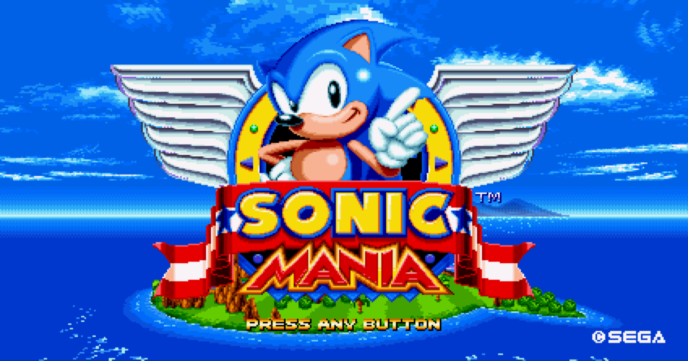
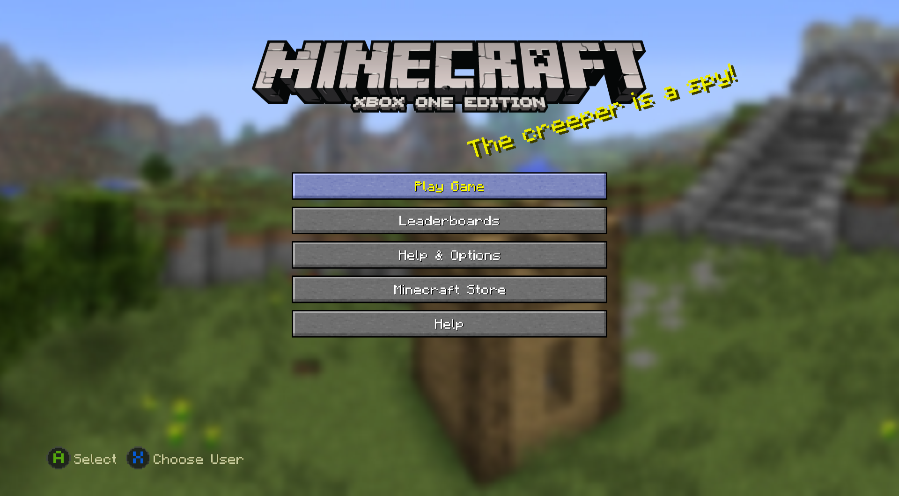

<p align="center"></p>

# XB1Layer

An experimental compatibility layer for running Xbox One (GDK/XDK "Durango") x64 titles on Windows x64.

**The aim is to be compatible with a wide range of Xbox One games**, not one title. Anything specific to a single title is a stand-in to be replaced by a general implementation. **Sonic Mania** is the first title that runs, and **Minecraft Xbox One Edition** (1.2.0.0) is the second: both were chosen because they are simple (plain D3D11, XAudio2). The Forza Horizon 3 kiosk demo that was used to find the first console API needs is retired; the next target is a full Forza Horizon game (2, 3 or 4) once a dump is available.

**Status: early prototype. Sonic Mania is playable and Minecraft Xbox One Edition loads and renders a world, both with picture, sound and input.** The layer loads unpacked Xbox One titles, runs them through startup into their main loop, and presents their frames in a native window. The goal is a layer that runs titles without graphical glitches; it is not there yet. Only these two titles have been tried, and only the parts played so far (Sonic Mania: intro, menus and the early part of the first zone; Minecraft: the menus and the first minutes of a generated world, judged by eye).

## What works
- **Sonic Mania** boots and plays: intro, logos, menus and the first zone, with picture (desktop D3D11 through the layer's proxy device, 60 FPS limiter) and sound (XAudio2). No graphical glitches seen in what was played. Not yet tested: later zones, special stages, two-player split screen, DualSense over USB.
- **Input**: an XInput gamepad, a DualSense (USB or Bluetooth, read directly through HID; Bluetooth verified in both titles), or the keyboard while the window has focus: arrows = d-pad, Z/X/A/S = A/B/X/Y, Enter = Menu, Backspace = View, Q/W = shoulders, I/K/J/L = left stick, numpad 8/5/4/6 = right stick, R/E = left/right trigger.
- **Loader**: manual PE64 loader, import report, `kernelx.dll` forwarded to `kernel32.dll`, DLLs next to the title searched first, the title's own console DLLs mapped by the layer.
- **Process bootstrap**: exception tables, PEB image base, per-thread static TLS, console `VirtualAlloc` flag handling, `XMem*` and `TitleMemoryStatus`, `G:` mapped to the title folder.
- **WinRT shell** (`src/winrt.rs`): own `CoreApplication`, view, window and dispatcher run the title's lifecycle; console-only `Windows.Xbox.*` and `Microsoft.Xbox.*` classes are served by stand-ins (one signed-in user, a gamepad, `SystemUI`, strings, event subscriptions) whose method shapes come from call sites.
- **Graphics** (`src/gpu.rs`, `src/display.rs`): `D3D11XCreateDeviceX` and plain `D3D11CreateDevice` return proxy device and context objects over a real desktop device. The console's embedded context function table is decoded where evidenced (including the packed `DrawIndexed` and the state the title keeps in the context object instead of calling bind methods). The swap chain is redirected to a native window. `XB1_D3D_DEBUG=1` turns on the D3D11 debug layer.
- **Audio**: proxy for the console extension of `MMDeviceEnumerator`, console audio HAL stand-ins.
- **Diagnostics**: crash-proof ring trace (`--ring=`, `tools\read-ring.ps1`), `--watch-sites`, hardware write watches (`XB1_HWBP*`), a sampling profiler (`XB1_PROFILE=1`), `--test-d3d`, per-call GPU logging.

- **Minecraft Xbox One Edition (1.2.0.0, an older XDK)**: the main menu, Play Game, Start Game and Create New World work, and a generated world renders in 3D with the HUD at 60 FPS in a release build (about 3,200 draw calls per frame). Keyboard and DualSense input work (the user confirmed every control), and the game has sound. The layer wraps this XDK's older DXGI/D3D11 layout and its embedded context calls, completes its storage, Xbox Live and system-keyboard operations, hands the game zeroed heap blocks (it relies on them), and carries one guarded compatibility patch (it keeps the default options when the stand-in storage returns a blank profile). Details in [FINDINGS](docs/FINDINGS.md).

## What does not work
- **Forza Horizon 3 (full game, 1.0.125.0)**: gets through startup and file mounting, shows the intro videos in full colour and reaches the press-start screen at a steady frame rate: the "PRESS TO START" text and the version line appear (UI overlay plane composited over the swap chain). The main-menu background is still black, the pad does not advance the screen (the pad answers are in the code but untested), the version string is random per run, and about half of the runs crash on a start-up race (start it again). The console compute stage (Dispatch, CS shader/UAV/samplers/constant buffers) is now forwarded without changing the picture. Title-specific workaround: the layer writes the game's "render enabled" request (`XB1_FH3_BOOT=0` turns it off). See `docs/FINDINGS.md`.
- **Forza Horizon 3 kiosk demo** (retired): booted into its main loop but never drew or presented. It writes AMD PM4 command packets that nothing decodes, uses placed textures with console tiling that is not de-tiled, and its D3D11X present path (`DXGIXPresentArray`, `DXGIXSetVLineNotification`) is still a logging stub.
- **Minecraft**: nothing is saved (the storage stand-ins keep no data); the Minecraft store button reportedly crashes the game (user report, not investigated); the credits screen shows no text (only its blurred backdrop); Join Game and anything online are untested; dialogs were seen with the menu text drawn through them (not re-checked); the 3D picture has only been looked at, not compared with a console; the topology of draws is partly guessed; a startup crash in the input table (`0x53be0e`) hit about half of the runs before the zeroed-allocation fix and none in 10 runs since.
- **Other titles**: untested. Console context-table indices 23 and 24 to 31 are unidentified, and anything not evidenced by a logged call only logs.
- D3D12.X titles are not supported.

## Screenshots

The window shows the game name, the frame rate and the logo. Captured from the layer's window (`tools/screenshot-window.ps1`):

| Sonic Mania (title screen) | Minecraft Xbox One Edition (main menu) |
|---|---|
|  |  |

## Build and run
Requires Rust (MSVC toolchain, x64). Use a release build to play: the debug build is several times slower (in Minecraft the difference between a playable and an unplayable frame rate).

```
cargo build --release                      # use target\release\xb1layer.exe to play
cargo build
cargo run -- path\to\title.exe            # load only, print import summary
cargo run -- path\to\title.exe --imports  # also list every stubbed import, grouped by DLL
cargo run -- path\to\title.exe --run      # also run the entry point
```

For example, Sonic Mania, from its own folder: `xb1layer.exe "SonicMania.exe" --run`.

Debug flags for `--run`: `--watch=N`, `--trace-api`, `--trace-heap`, `--iat`, `--ring=`, `--watch-sites=`. Environment switches (the full list, with what each does, is in [Architecture](docs/ARCHITECTURE.md#debugging-aids)): `XB1_D3D_DEBUG=1` (D3D11 debug layer), `XB1_FPS=<n>` (frame limit, default 60, 0 = off), `XB1_PROFILE=1` (which module the presenting thread is in), `XB1_DS_LOG=1` (DualSense stick values), `XB1_NO_COMPAT=1` (turn the per-title patches off), `XB1_LOG_ALL=1`, `XB1_CTX_TRACE=n`, `XB1_STORAGE_TRACE=1`, `XB1_HWBP=...`.

Run a title from its own folder so relative paths resolve.

## Scope and legal
- Works only with content you own and have already unpacked/decrypted by legitimate means.
- This project does not include, and will not include, code for breaking package encryption, extracting keys, or bypassing DRM.
- No Microsoft binaries or game assets are included in this repository.
- Not affiliated with or endorsed by Microsoft. Xbox, Xbox One, Durango and Forza Horizon are trademarks of Microsoft; they are used here only to say what the software is compatible with.
- This project does not help obtain titles.

## License
[MIT](LICENSE).

## Contributing
Contributions are welcome. The biggest open problems are mapping the rest of the console's embedded context functions to desktop D3D11 and, for titles that use it, decoding the GPU command packets (see the [Roadmap](docs/ROADMAP.md)). Reports of what other titles need are useful too.

## Docs
- [Architecture](docs/ARCHITECTURE.md)
- [Findings](docs/FINDINGS.md) (a chronological log: the Forza Horizon 3 kiosk demo, Sonic Mania and Minecraft; later sections correct earlier ones)
- [Roadmap](docs/ROADMAP.md)
